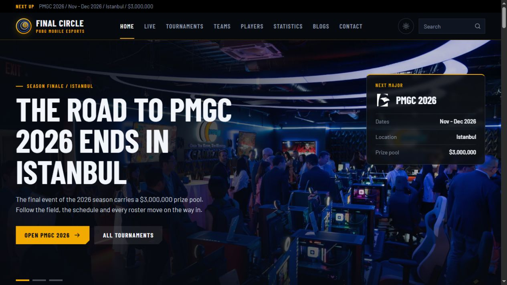
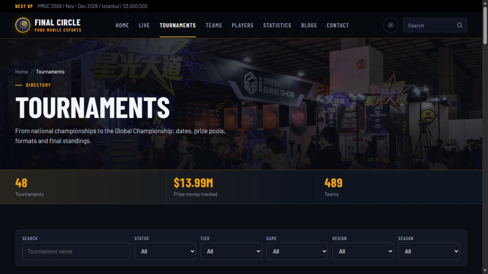
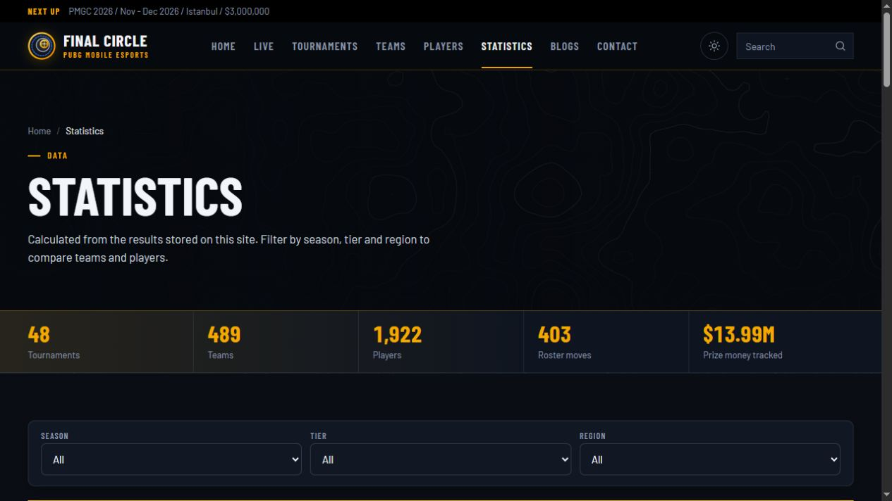

# Hi, I'm Muhammad Usman

I'm a web developer based in Lahore, Pakistan. I have two years of experience building and maintaining responsive WordPress sites, including installing, configuring, and developing custom plugins. I also build Shopify storefronts and Wix websites.

## What I work on

- **WordPress** — Responsive websites and custom plugins
- **Shopify and Wix** — Online stores and websites
- **Vibe coding** — I use AI-assisted coding to turn software ideas into working prototypes, then review the code, test features, and refine the implementation.

## Connect with me

[LinkedIn](https://www.linkedin.com/in/usmansheikh6412/)

## Featured Project — Final Circle Esports

I built this PUBG Mobile esports website for a South Asian audience using a custom WordPress plugin developed with AI-assisted coding. The portal brings tournament schedules, match results, and esports coverage into one place.

- **Tournament directory** with filters for status, tier, game, region, and season.
- **Team and player directories** alongside roster transfer coverage.
- **Event pages** with schedules, stage-by-stage standings, match results, and prize breakdowns.
- **Statistics dashboard** with season, tier, and region filters.

**Status:** Deployed to staging.

### AI Vibe Coding

I used AI-assisted coding to turn the portal’s feature ideas into a working WordPress plugin. I described the behavior I wanted in prompts, reviewed the generated code, and refined it through testing on the staging site. This workflow helped me build and improve features such as tournament filters, team and player directories, and event results pages.

### Project screenshots

### Live event page

The Live page brings the featured tournament’s format, match schedule, broadcast links, prize breakdown, and stage-by-stage standings together. Visitors can also explore game-by-game results and team lineups.
